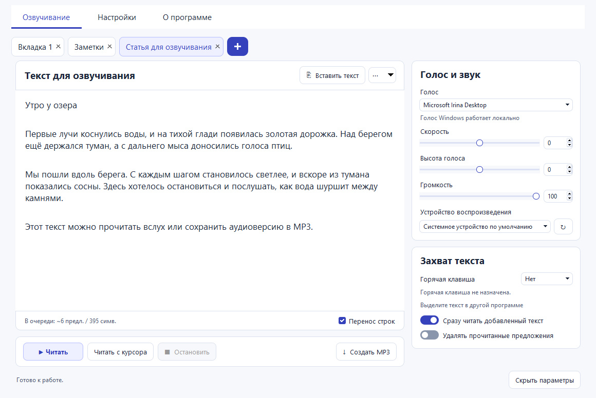
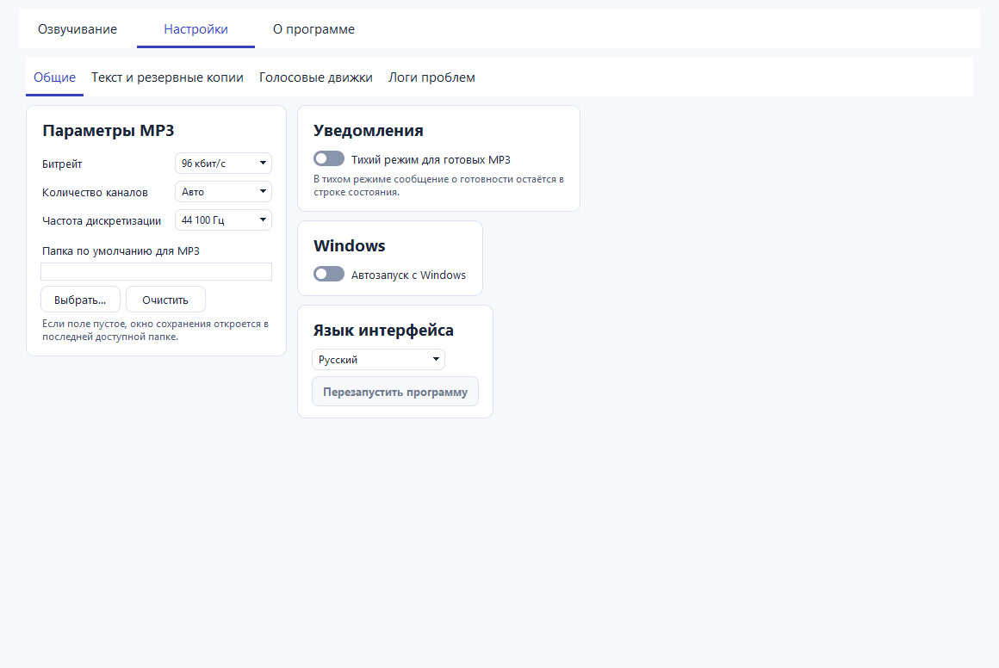
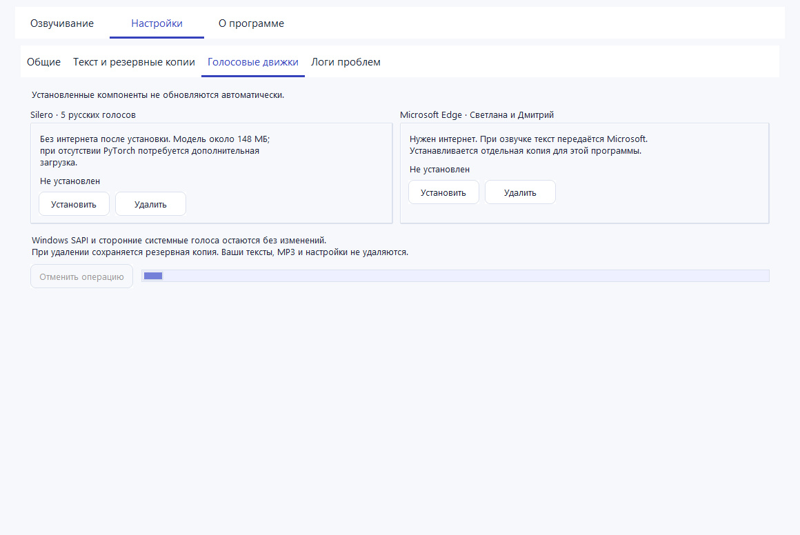

# ZeTer Voice

**Язык / Language:** **Русский** · [English](README_EN.md)

ZeTer Voice озвучивает текст на Windows и сохраняет его в MP3. Вставьте текст, откройте TXT или Markdown либо перенесите выделенный фрагмент из другой программы горячей клавишей. Держите статьи, заметки и тексты для озвучивания в отдельных вкладках.

**[Скачать ZeTer Voice для Windows](https://github.com/zeter1/ZeTer-Voice/releases)** · Windows 10/11 x64 · Предварительная сборка

## Первый MP3

1. На странице **Releases** откройте **Assets** и скачайте `ZeTer-Voice-x64.zip`. Рядом опубликована контрольная сумма SHA-256.
2. Распакуйте архив целиком и запустите `ZeTer-Voice.exe` из распакованной папки. Оставьте все папки дистрибутива рядом с EXE. Python и FFmpeg уже входят в комплект.
3. Вставьте во вкладку фразу «Это пробная запись ZeTer Voice». В панели **Голос и звук** выберите установленный голос Windows с подходящим языком и нажмите **Читать**, чтобы услышать фразу.
4. После прослушивания нажмите **Создать MP3**, выберите папку и имя файла. Когда обработка завершится, откройте MP3 в выбранной папке.



## Как выбрать голос

| Движок | Когда выбрать | Интернет и обработка текста |
| --- | --- | --- |
| **Windows SAPI** | Для быстрого старта с установленным голосом Windows | Системные голоса Windows озвучивают текст локально |
| **Silero** | Для озвучивания на русском одним из пяти голосов, например Ксенией или Айдаром | Интернет нужен для установки. После неё озвучивание работает локально |
| **Microsoft Edge** | Для онлайн-озвучивания голосом Светлана или Дмитрий | Нужен интернет. Текст для озвучивания передаётся Microsoft |

Silero и Microsoft Edge можно установить в разделе **Настройки → Голосовые движки**. После установки выберите нужный голос в панели **Голос и звук**. [Подробнее об установке и обработке текста](docs/VOICE_ENGINES.md)

## Работа с текстом и MP3

- **Захват из другой программы.** Назначьте вкладке F8 или другое сочетание в панели **Захват текста**. Выделите текст в исходном окне и нажмите эту клавишу. При сбое уведомление подскажет причину. Для ручного переноса скопируйте текст в исходном окне и вставьте его в нужную вкладку.
- **Текстовые вкладки.** Создавайте отдельную вкладку для каждого текста и перетаскивайте вкладки за названия. Для TXT и Markdown используйте **Открыть текстовый файл…** в меню **⋯** редактора. Программа запоминает названия и порядок вкладок. Сохранение текста включено по умолчанию.
- **Прослушивание.** Выберите голос, скорость, тон, громкость и устройство воспроизведения. Используйте **Читать с курсора**, чтобы начать с нужного места. Во время чтения можно поставить воспроизведение на паузу и продолжить. Если текст нужен для MP3, отключите удаление прочитанных предложений.
- **Запись.** В разделе **Настройки → Общие** задайте битрейт, число каналов, частоту дискретизации и папку для MP3. В файл попадает текст на момент подтверждения имени. При восстановлении прерванной задачи программа использует уже готовые и проверенные звуковые фрагменты. Если во время записи выбранный путь занял другой файл, новый MP3 сохраняется под свободным именем.

## Настройки и сохранение данных

- **Язык интерфейса.** В **Настройки → Общие → Язык интерфейса** доступны русский, английский, испанский, польский, французский и португальский (Бразилия). После выбора нажмите **Перезапустить программу**. Голос озвучивания выбирается отдельно.
- **Резервные копии.** В разделе **Настройки → Текст и резервные копии** можно настроить сохранение текста и срок хранения архивов. По умолчанию история вкладок и копии текста для MP3 хранятся 30 дней.
- **Диагностика.** В разделе **Настройки → Логи проблем** выбираются запись логов и срок хранения. Если нужно сообщить о сбое, используйте короткий вымышленный текст и следуйте [инструкции по поддержке](SUPPORT.md).

Обычно настройки, вкладки и данные восстановления лежат рядом с запущенной копией программы. Перед переносом или обновлением проверьте [расположение данных](docs/PROJECT.md#постоянные-данные) и [инструкцию обновления](ОБНОВЛЕНИЕ_ИНСТРУКЦИЯ.txt).

### Как выглядят настройки





## Запуск из исходников

Понадобится Python 3.13 для Windows с командой `py`. Скачайте исходники через **Code → Download ZIP** и распакуйте их или клонируйте репозиторий с помощью Git. В PowerShell откройте папку, в которой находится `ZeTer Voice.py`, и выполните команды ниже.

```powershell
py -3.13 -m venv .venv
.\.venv\Scripts\python.exe -m pip install -r requirements.txt
.\.venv\Scripts\python.exe "ZeTer Voice.py"
```

Голоса SAPI берутся из Windows. Для MP3 используется FFmpeg из `PATH` или из зависимости `imageio-ffmpeg`.

- [Обзор проекта](docs/PROJECT.md) и [карта кода](docs/CODEMAP.md)
- [Сборка EXE](BUILD_EXE.md) и [проверки в изолированной копии](docs/VERIFICATION.md)
- [История изменений](CHANGELOG.md), [поддержка](SUPPORT.md) и [безопасность и приватность](SECURITY.md)

## Лицензия

Открытая лицензия в настоящее время не предоставляется. Исходный код опубликован для портфолио и ознакомления с реализацией.

## Контакты для связи с разработчиком

- [zeter11@gmail.com](mailto:zeter11@gmail.com)
- [https://t.me/zeter1](https://t.me/zeter1)
- [https://www.linkedin.com/in/zeter/](https://www.linkedin.com/in/zeter/)
- [https://www.facebook.com/zeter1](https://www.facebook.com/zeter1)
- [https://vk.ru/zeter1](https://vk.ru/zeter1)
- [https://www.instagram.com/zeter1992/](https://www.instagram.com/zeter1992/)
- [https://tenchat.ru/zeter](https://tenchat.ru/zeter)
- [https://x.com/zeter1](https://x.com/zeter1)
- [https://www.threads.com/@zeter1992](https://www.threads.com/@zeter1992)
- [https://ok.ru/zeter1](https://ok.ru/zeter1)
- [https://t.me/zeterchat](https://t.me/zeterchat) — Telegram-группа: обо мне, проекты и чат
- [https://dkoles.com/](https://dkoles.com/) - сайт.
