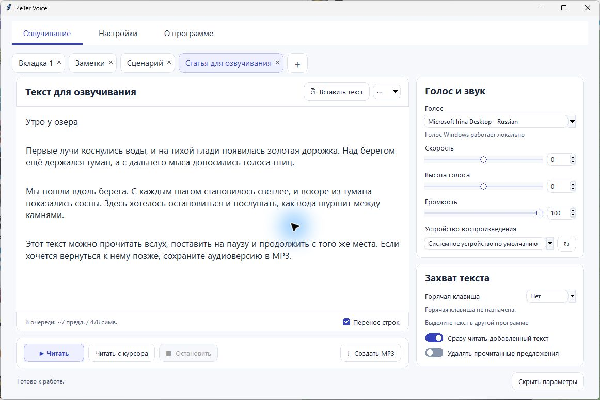
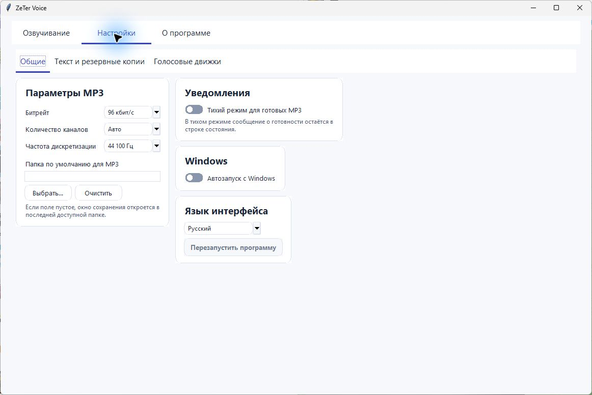
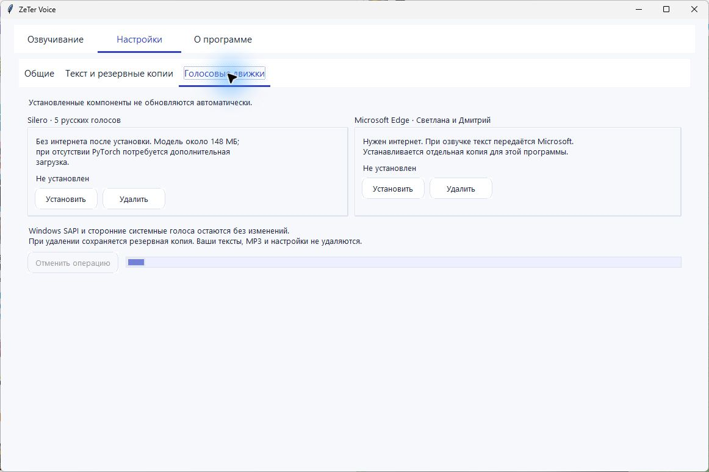

# ZeTer Voice

**Язык / Language:** [Русский](README.md) · **English**

ZeTer Voice reads text aloud on Windows and saves it as MP3. Paste text, open a TXT or Markdown file, or capture selected text from another app with a hotkey. Keep articles, notes, and scripts in separate tabs.

**[Download ZeTer Voice for Windows](https://github.com/zeter1/ZeTer-Voice/releases)** · Windows 10/11 x64 · Pre-release build

## Create your first MP3

1. Open **Assets** on the **Releases** page and download `ZeTer-Voice-x64.zip`. A SHA-256 checksum is published alongside the ZIP.
2. Extract the entire archive and run `ZeTer-Voice.exe` from the extracted folder. Keep all bundled folders beside the EXE. Python and FFmpeg are included. The interface starts in Russian. For English, open **Настройки → Общие → Язык интерфейса**, choose **English**, then click **Перезапустить программу**.
3. Paste “This is a ZeTer Voice test recording” into a tab. In **Voice and audio**, choose an installed Windows voice that matches the text language, then click **Read** to listen.
4. After listening, click **Create MP3**, choose a folder and file name, and open the MP3 in that folder when the job finishes.



## Choose a voice

| Engine | When to use it | Connection and text processing |
| --- | --- | --- |
| **Windows SAPI** | Get started with a voice already installed in Windows | Windows system voices process text locally |
| **Silero** | Read Russian using one of five voices, such as Ksenia or Aidar | Internet access is required for setup. Speech synthesis then runs locally |
| **Microsoft Edge** | Read Russian online with Svetlana or Dmitry | Internet access is required. Text is sent to Microsoft for speech synthesis |

Install Silero or Microsoft Edge under **Settings → Voice engines**, then select a voice in **Voice and audio**. [Voice engine setup and text processing](docs/VOICE_ENGINES.md)

## Work with text and MP3 files

- **Capture from another app.** Assign F8 or another hotkey to a tab under **Text capture**. Select text in the source window and press the assigned key. If capture fails, a notification explains why. You can also copy the text manually and paste it into the target tab.
- **Text tabs.** Keep texts in separate tabs and drag tabs by their names to reorder them. To load TXT or Markdown, choose **Open text file…** in the editor’s **⋯** menu. The app remembers tab names and order. It saves tab text by default.
- **Listen.** Choose the voice, rate, pitch, volume, and playback device. Use **Read from cursor** to start from a chosen point. You can pause and resume playback. If you plan to export the same text, turn off automatic removal of already-read sentences.
- **Export.** Set the bitrate, channel count, sample rate, and default MP3 folder under **Settings → General**. The export uses the text as it was when you confirmed the file name. When resuming an interrupted job, the app reuses completed, verified audio segments. If another file takes the chosen path while export is running, the app saves the new MP3 under an available name.

## Settings and saved data

- **Interface language.** In **Settings → General → Interface language**, choose Russian, English, Spanish, Polish, French, or Brazilian Portuguese, then click **Restart application**. Choose the reading voice separately.
- **Backups.** In **Settings → Text and backups**, configure text saving and archive retention. Tab history and text backups for MP3 jobs are kept for 30 days by default.
- **Diagnostics.** Use **Settings → Problem logs** to control logging and retention. To report a problem, use a short sample with invented text and see the [support guide](SUPPORT.md).

Settings, tabs, and recovery data are usually stored beside the copy of the app you launched. Before moving or updating the app, check the [data locations](docs/PROJECT.md#постоянные-данные) and [update instructions](ОБНОВЛЕНИЕ_ИНСТРУКЦИЯ.txt).

### Settings screenshots





## Run from source

You need Python 3.13 for Windows with the `py` command. Download and extract the source using **Code → Download ZIP**, or clone the repository with Git. Open PowerShell in the folder containing `ZeTer Voice.py` and run the commands below.

```powershell
py -3.13 -m venv .venv
.\.venv\Scripts\python.exe -m pip install -r requirements.txt
.\.venv\Scripts\python.exe "ZeTer Voice.py"
```

SAPI uses voices installed in Windows. MP3 export uses FFmpeg from `PATH` or the `imageio-ffmpeg` dependency.

- [Project overview](docs/PROJECT.md) and [code map](docs/CODEMAP.md)
- [Build the EXE](BUILD_EXE.md) and [run checks in an isolated copy](docs/VERIFICATION.md)
- [Changelog](CHANGELOG.md), [support](SUPPORT.md), and [security and privacy](SECURITY.md)

## License

No open-source license is currently granted. The source code is published for portfolio review and implementation study.

## Developer contacts

**Язык / Language:** [Русский](README.md#контакты-для-связи-с-разработчиком) · **English**

- [zeter11@gmail.com](mailto:zeter11@gmail.com)
- [https://t.me/zeter1](https://t.me/zeter1)
- [https://www.linkedin.com/in/zeter/](https://www.linkedin.com/in/zeter/)
- [https://www.facebook.com/zeter1](https://www.facebook.com/zeter1)
- [https://vk.ru/zeter1](https://vk.ru/zeter1)
- [https://www.instagram.com/zeter1992/](https://www.instagram.com/zeter1992/)
- [https://tenchat.ru/zeter](https://tenchat.ru/zeter)
- [https://x.com/zeter1](https://x.com/zeter1)
- [https://www.threads.com/@zeter1992](https://www.threads.com/@zeter1992)
- [https://ok.ru/zeter1](https://ok.ru/zeter1)
- [https://t.me/zeterchat](https://t.me/zeterchat) — Telegram group: about me, projects and chat
- [https://dkoles.com/](https://dkoles.com/) - project website.
